# Actividad práctica: Mi primer proyecto con Spring Boot

## Sara Colmenares
---
## Objetivo

Desarrollar, ejecutar y probar una aplicación básica utilizando Spring Boot, con el propósito de comprender los fundamentos del desarrollo de servicios web mediante el protocolo HTTP y la arquitectura REST.

Durante la actividad se implementaron controladores, servicios, inyección de dependencias y configuración externa. Asimismo, se exploró el uso de las anotaciones principales del framework, la administración de dependencias mediante Maven y la comprobación de endpoints utilizando un navegador web y Postman.

---
## Instalacion

Para desarrollar la aplicación se utilizó IntelliJ IDEA como entorno de desarrollo integrado (IDE), debido a que proporciona herramientas para la creación, edición, ejecución y depuración de proyectos Java.

1. Se ingresó al sitio oficial de JetBrains: https://www.jetbrains.com/idea/download/ y se descargó el instalador correspondiente al sistema operativo Windows.

2. Se ejecutó el archivo .exe descargado y se siguieron las instrucciones del asistente de instalación, seleccionando la opción Next para continuar.

3. Se seleccionó la carpeta de instalación predeterminada. Posteriormente, en las opciones de instalación, se habilitó la creación de un acceso directo en el escritorio mediante la opción Create Desktop Shortcut.

4. Finalmente, se completó el proceso de instalación seleccionando Finish.

Con esta instalación se obtuvo el entorno necesario para crear y ejecutar el proyecto Java con Spring Boot.

---
## Parte 1

Se creó un nuevo proyecto desde IntelliJ IDEA, seleccionando las opciones correspondientes para desarrollar una aplicación con Java y Spring Boot.

**New project**

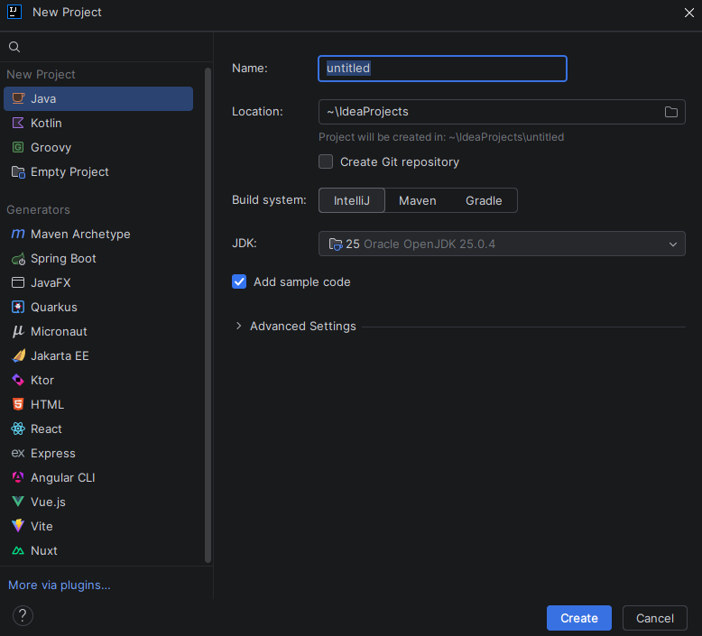

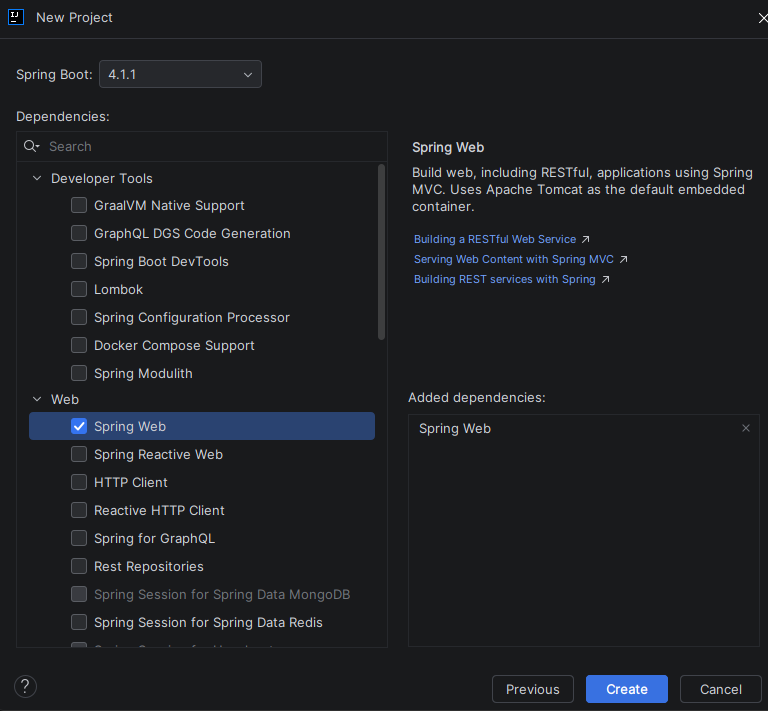

Durante la configuración se definieron los datos iniciales del proyecto, incluyendo su nombre, el lenguaje de programación, la versión de Java y las opciones necesarias para generar la estructura base de la aplicación.

El proyecto se denominó holamundo1 y se generó la clase principal Holamundo1Application, encargada de iniciar la aplicación.

Spring Boot simplifica la configuración inicial de los proyectos Java, ya que proporciona una estructura predeterminada y administra gran parte de los componentes necesarios para ejecutar una aplicación web.

Resultado obtenido: se creó la estructura inicial del proyecto y se dispuso de una clase principal desde la cual ejecutar la aplicación.

---
## Parte 2

Se identificaron los directorios y archivos principales generados por Spring Boot y utilizados durante el desarrollo.

src/main/java: contiene el código fuente de la aplicación, incluyendo la clase principal, los controladores, los servicios y las clases de configuración.

src/main/resources: almacena los recursos de la aplicación, entre ellos el archivo application.properties, utilizado para definir propiedades de configuración.

pom.xml: contiene la configuración de Maven, las dependencias del proyecto y otros parámetros de compilación.

target: almacena los archivos generados durante la compilación. Es un directorio de salida que puede regenerarse a partir del código fuente y la configuración del proyecto.

Esta revisión permitió diferenciar los archivos que se modifican durante el desarrollo de aquellos que se generan automáticamente al compilar la aplicación.

Resultado obtenido: se reconoció la organización básica de un proyecto Spring Boot y la ubicación de los archivos necesarios para implementar las funcionalidades solicitadas.

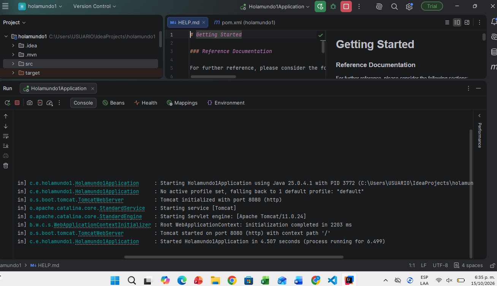

---
## Parte 3

Se examinó el archivo pom.xml, utilizado por Maven para administrar la configuración y las dependencias del proyecto.

En este archivo se definen las bibliotecas que necesita la aplicación para funcionar. Entre ellas se encuentra Spring Boot, que proporciona los componentes necesarios para desarrollar aplicaciones Java y servicios web.

También se revisaron los parámetros asociados al proyecto, como su identificación y la configuración de compilación.

Maven facilita la gestión de las dependencias, evitando la necesidad de descargar y configurar manualmente cada biblioteca. De esta manera, el proyecto puede compilarse y ejecutarse utilizando la configuración declarada en el archivo.

Resultado obtenido: se comprendió la función del archivo pom.xml en la administración de dependencias y en la configuración general del proyecto.

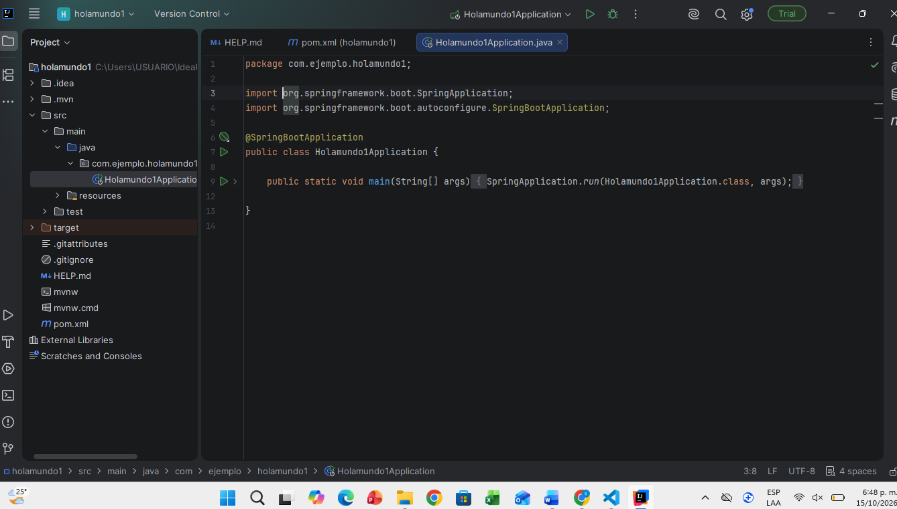

Estas es la parte del archivo pom:

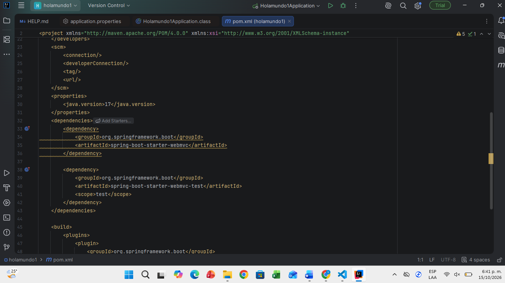

---
## Parte 4

Se creó la clase HolaMundoController dentro del paquete controller, con el objetivo de exponer un endpoint HTTP que devolviera un mensaje de texto.

Para implementar este comportamiento se utilizaron las siguientes anotaciones:

@RestController: identifica la clase como un controlador REST. Los valores devueltos por sus métodos se envían directamente en la respuesta HTTP.

@RequestMapping("/api"): establece la ruta base para los endpoints definidos en el controlador.

@GetMapping("/hola"): asocia el método correspondiente con las solicitudes HTTP GET realizadas a la ruta /api/hola.

El método holaMundo() devuelve el texto:

¡Hola Mundo desde Spring Boot!

Una vez implementado el controlador, se ejecutó la aplicación desde IntelliJ IDEA y se comprobó que el servidor iniciara correctamente.

Posteriormente, se ingresó en el navegador a la siguiente dirección:

http://localhost:8080/api/hola

La respuesta obtenida confirmó que el servidor procesó la solicitud y devolvió el mensaje esperado.

Resultado obtenido: se implementó y verificó el primer endpoint REST, comprendiendo la relación entre un controlador, una ruta HTTP y la respuesta enviada al cliente.

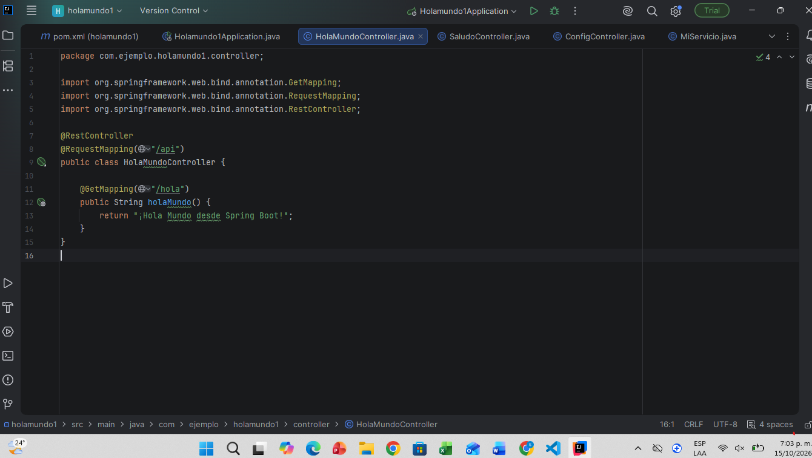

---
## Parte 5

En esta etapa se separó la lógica de obtención del mensaje de la clase encargada de atender las solicitudes HTTP. Para ello, se creó el servicio MiServicio dentro del paquete service.

La clase MiServicio utiliza la anotación @Service, que permite a Spring reconocerla como un componente administrado por el contenedor de la aplicación.

El servicio implementa el método obtenerSaludo(), que devuelve el mensaje:

¡Hola desde el servicio!

Posteriormente, se creó el controlador SaludoController, responsable de recibir las solicitudes dirigidas a la ruta /saludo y solicitar al servicio el mensaje que debe devolver.

Para utilizar el servicio se aplicó el principio de inyección de dependencias mediante constructor. En lugar de crear manualmente una instancia de MiServicio dentro del controlador, Spring proporciona el objeto administrado por su contenedor.

Este mecanismo reduce el acoplamiento entre las clases y facilita el mantenimiento y las pruebas de la aplicación.

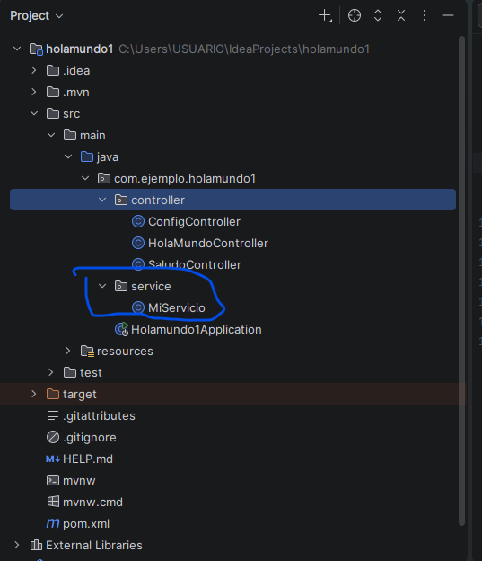

**Error**

**Normal**

**Saludo**

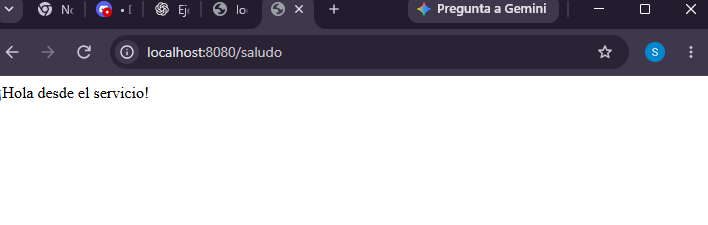

## Comprobación y análisis de errores

Durante la actividad se observó un error relacionado con la disponibilidad del servicio. Esta situación permitió reconocer que Spring necesita identificar y administrar los componentes requeridos por los controladores.

En particular, la anotación @Service permite registrar MiServicio como un componente que Spring puede proporcionar mediante la inyección de dependencias. Si se elimina dicha anotación sin registrar el servicio por otro mecanismo, la aplicación no podrá resolver la dependencia requerida por el controlador y puede fallar durante el inicio.

Después de restablecer la configuración necesaria, la aplicación volvió a ejecutarse correctamente.

Se verificó el funcionamiento de la ruta:

http://localhost:8080/saludo

La respuesta obtenida fue:

¡Hola desde el servicio!

Resultado obtenido: se comprendió la separación de responsabilidades entre controladores y servicios, el papel de @Service y el funcionamiento de la inyección de dependencias en Spring Boot.

---
## Parte 6

En esta etapa se incorporó una propiedad personalizada en el archivo src/main/resources/application.properties:

mensaje.bienvenida=¡Bienvenido a Spring Boot!

El propósito fue almacenar el mensaje fuera del código fuente Java y permitir que su contenido pudiera modificarse desde un archivo de configuración.

Posteriormente, se creó el controlador ConfigController, encargado de exponer el valor de dicha propiedad mediante un endpoint.

Para acceder a la configuración se utilizó la anotación @Value:

@Value("${mensaje.bienvenida}")

Esta anotación permite que Spring inyecte en el atributo correspondiente el valor definido para la propiedad mensaje.bienvenida.

Una vez configurado el controlador, se ejecutó la aplicación y se comprobó el mensaje devuelto por el endpoint.

La ruta utilizada fue:

http://localhost:8080/config

También se modificó el texto de la propiedad para comprobar que el contenido de la respuesta dependía de application.properties, sin necesidad de cambiar el método del controlador.

Después de guardar los cambios, se reinició la aplicación para verificar la nueva configuración.

Resultado obtenido: se implementó una propiedad externa y se accedió a ella desde un controlador utilizando @Value. Esto permitió comprender la utilidad de separar los valores de configuración de la lógica de programación.

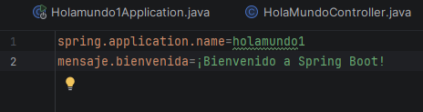

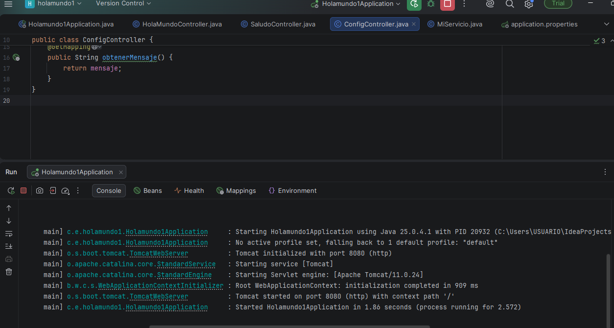
 
**Saludo**

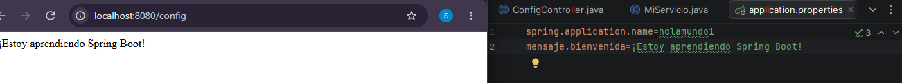

---
## Instalación postmarn

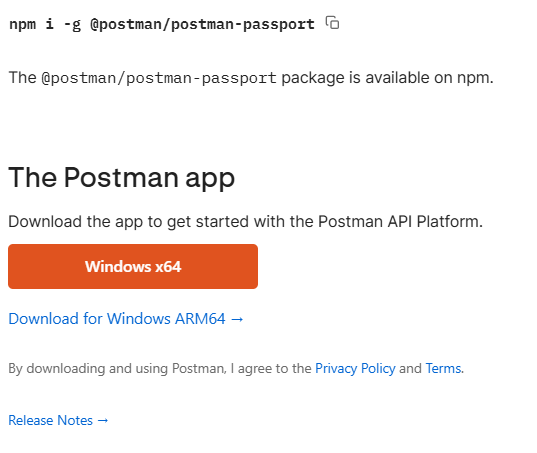

**Comprobacion**

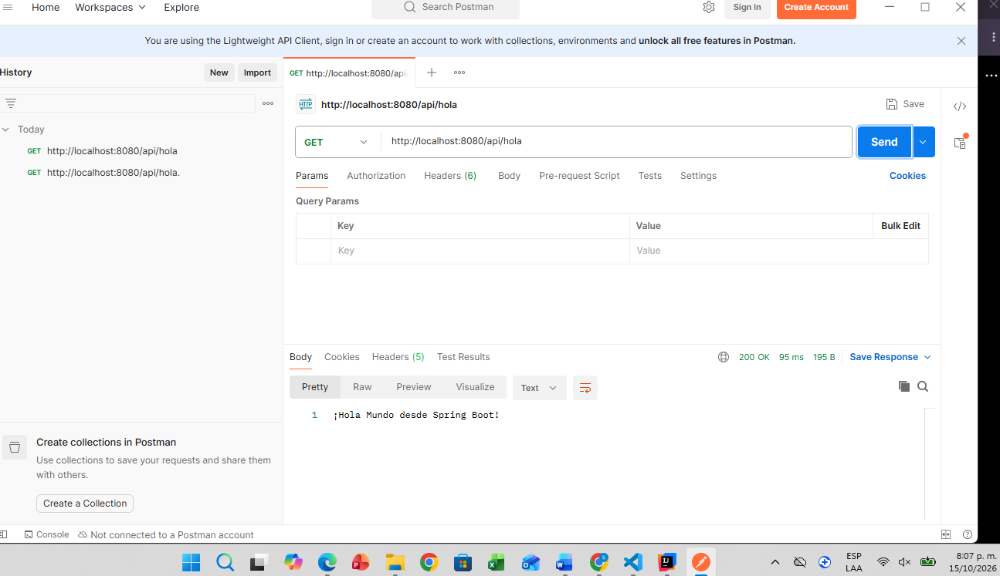