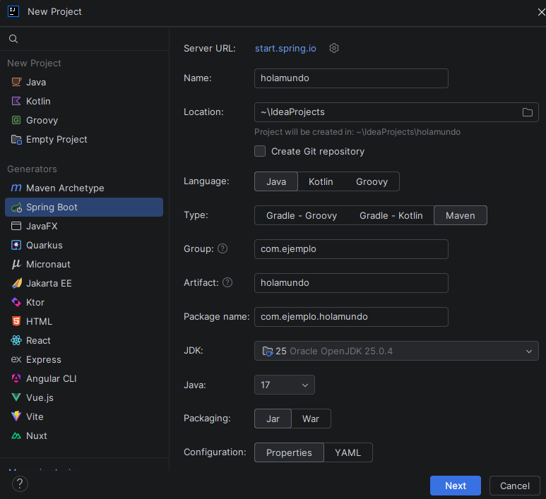
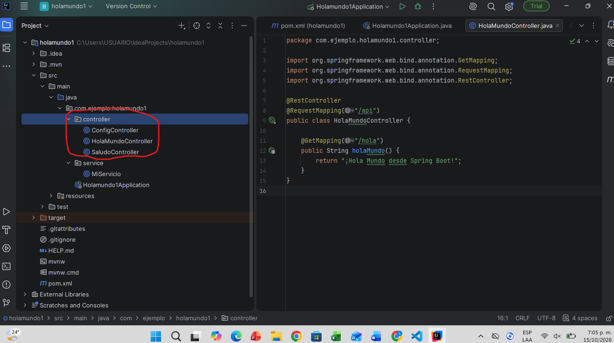
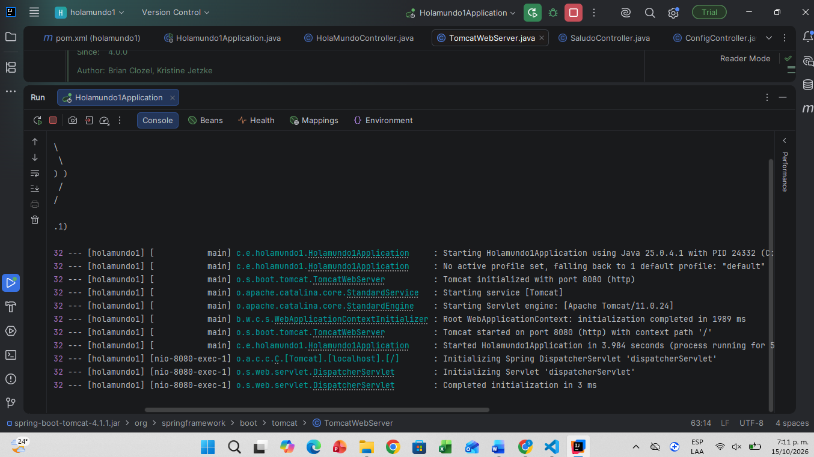
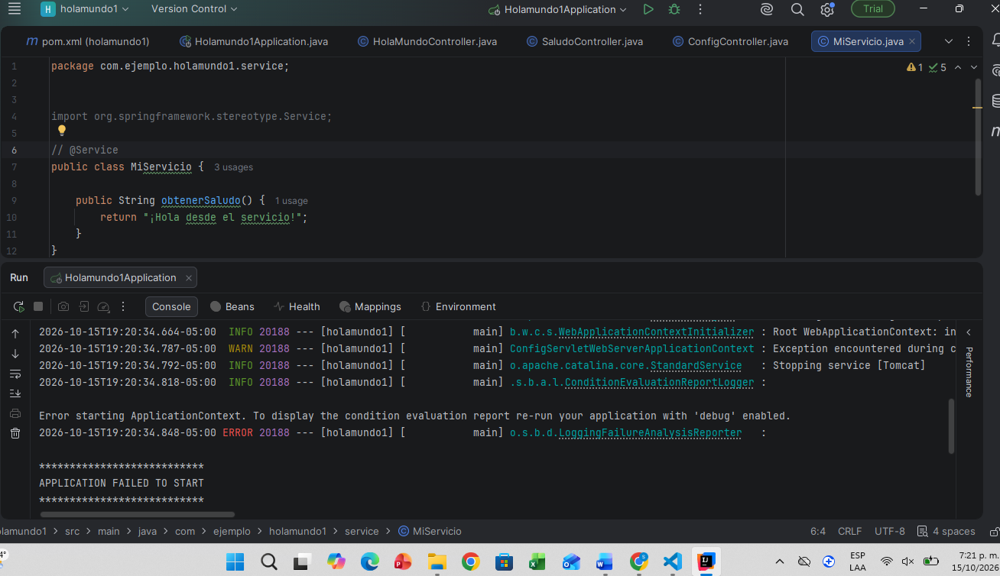
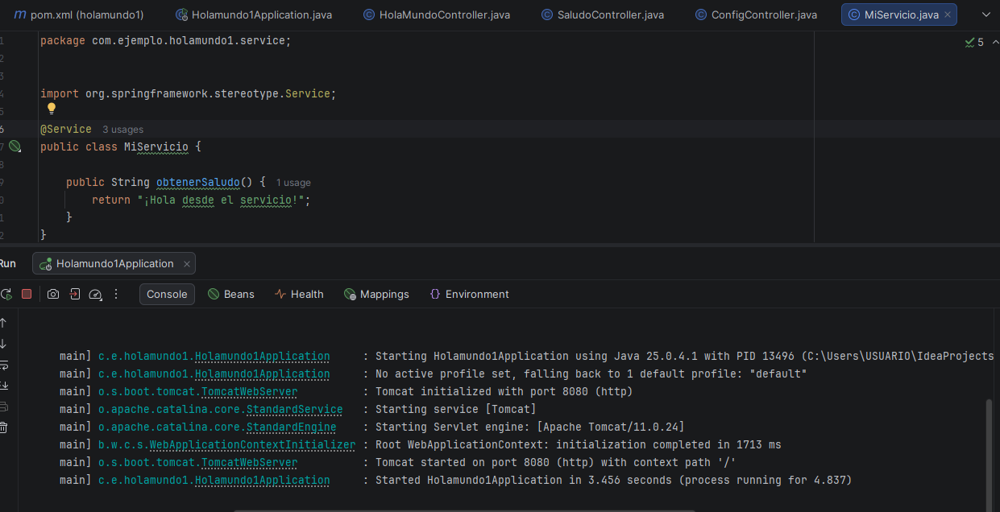
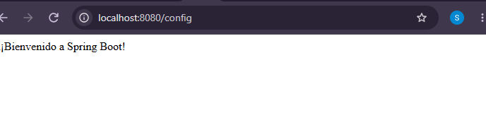

# Actividad práctica: Mi primer proyecto con Spring Boot

## Sara Colmenares

---
## Objetivo

Crear, ejecutar y probar una aplicación Spring Boot con tres endpoints REST, aplicando controladores, servicios, inyección de dependencias y configuración externa.

---
## Instalacion

Se opto por la instalación de  IntelliJ, el cual tuvo el siguiente proceso:

1. Ingresé a https://www.jetbrains.com/idea/download/ y descargue el instalador para mi sistema operativo, el cual es windows.

2. Ejecué el archivo .exe descargado y le di clic en Next.

3. Eligí la carpeta de instalación (por defecto) y di clic en Next.
En Installation Options marqué:
Create Desktop Shortcut (acceso directo en el escritorio).
Al terminar, hice clic en Finish..

---
## Parte 1

Cree el proyecto usando spring boot

**new project**

---
## Parte2

---
## Parte 3

Estas es la parte del archivo pom:

---
## Parte 4

---
## Parte 5

error

normal

saludo

---
## Parte 6

 saludo

 paso 5

descargo postmarn

 uso
 
