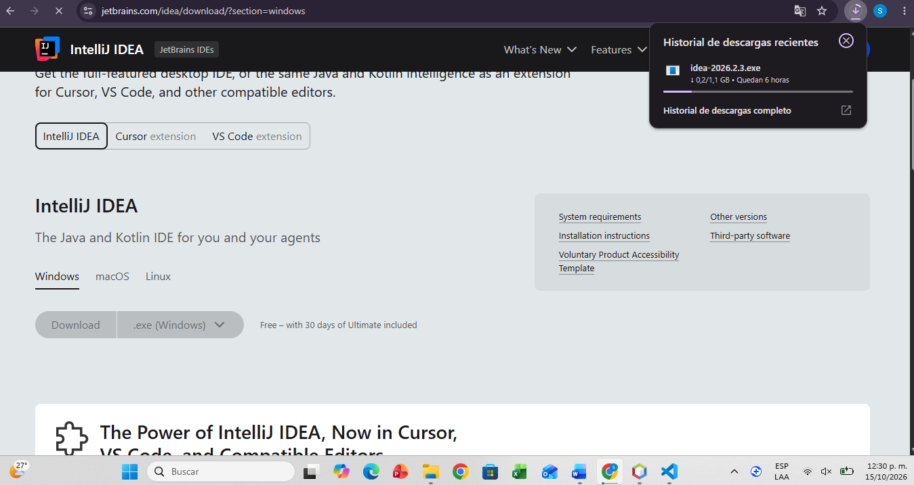

# Actividad práctica: Mi primer proyecto con Spring Boot
---
## Objetivo

Crear, ejecutar y probar una aplicación Spring Boot con tres endpoints REST, aplicando controladores, servicios, inyección de dependencias y configuración externa.

---
## Instalacion

Se opto por la instalación de  IntelliJ, el cual tuvo el siguiente proceso:

1. Ingresé a https://www.jetbrains.com/idea/download/ y descargue el instalador para mi sistema operativo, el cual es windows.

2. Ejecué el archivo .exe descargado y le di clic en Next.

3. Elige la carpeta de instalación (puedes dejar la que aparece por defecto) y haz clic en Next.
En Installation Options marca:
Create Desktop Shortcut (acceso directo en el escritorio).
.java en Create Associations (opcional).
En Choose Start Menu Folder deja el nombre JetBrains, no selecciones nada de la lista, deja sin marcar "Do not create shortcuts" y haz clic en Install.
Al terminar, haz clic en Finish. Si te pide reiniciar, puedes hacerlo de una vez o más tarde.